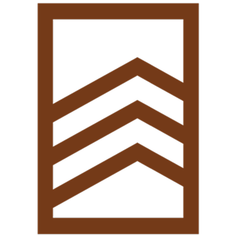
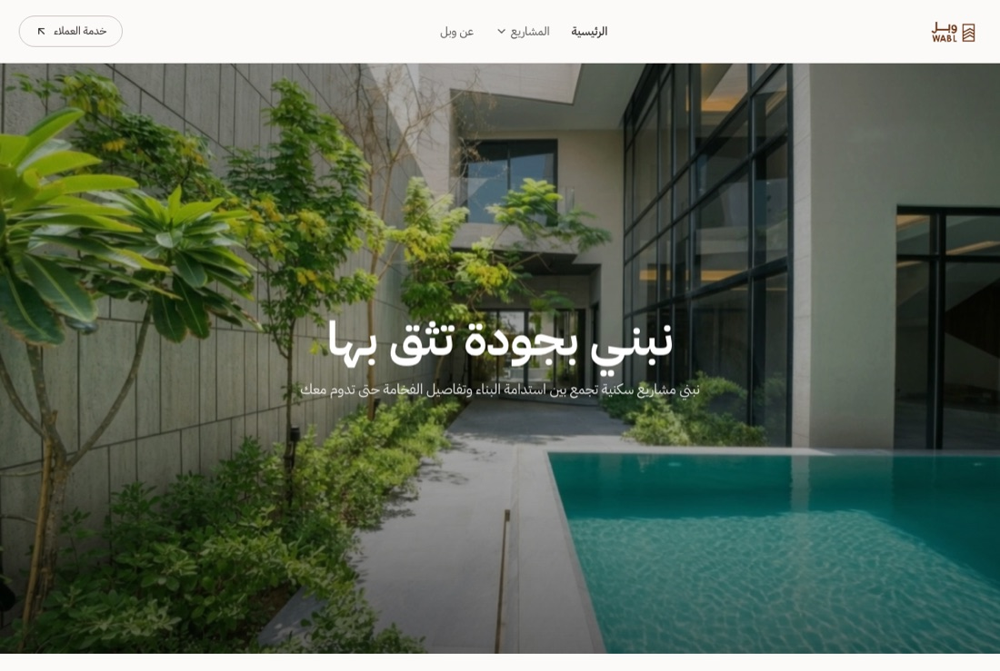
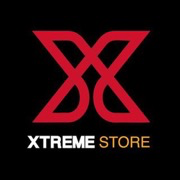
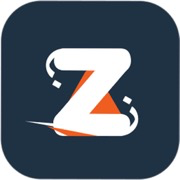
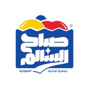

# Hi, I'm Moustafa Said Salha 👋

**Full-stack developer based in Egypt.** I started in mobile and never stopped at the client — today I build the whole product: React front ends, Node/Express and FastAPI backends, PostgreSQL data models, and the iOS/Android apps that sit on top of them.

---

## 🏠 About me

I build production software end to end. On the web that means Arabic-first React applications with a real CMS and CRM behind them; on mobile it means Flutter and native iOS apps that are live on the App Store. Most recently I shipped a complete real-estate platform — marketing site, sales CRM and analytics — for a developer in Saudi Arabia.

- 🏢 **Shipped [wabl.sa](https://wabl.sa)** — an Arabic-first real-estate platform: marketing site, lead capture, sales CRM, automated visit confirmations and marketing analytics.
- 🔭 **Currently building** a Fantasy Premier League decision-support platform (Flutter + NestJS + PostgreSQL monorepo) and a scroll-driven 3D portfolio in React Three Fiber.
- 📱 **Three production iOS apps** live on the App Store for clients in Kuwait, in English and Arabic.
- 🧰 **Comfortable across the stack** — Flutter/Dart, TypeScript/React, Node & Express, Python/FastAPI, PostgreSQL, Notion as a CMS, Firebase and Docker.
- 🌱 **Exploring** 3D/WebGL on the web and AI-assisted reporting on top of product data.
- 🤝 **Open to** full-stack and mobile engineering roles, plus freelance product work.
- 📫 **Reach me at** [moustafasaidsalha@gmail.com](mailto:moustafasaidsalha@gmail.com).

---

## ⚒️ Tech I work with

**Mobile**

  
  
  
  
  
  

**Frontend**

  
  
  
  
  
  
  

**Backend & data**

  
  
  
  
  
  
  
  
  
  

**Platform & tooling**

  
  
  
  
  
  
  
  

---

## 🏗 Featured work

###  Wabl — real-estate platform for a Saudi developer

An Arabic-first platform for **وبل العقارية (Wabl)**, a residential developer in Saudi Arabia. Not a brochure site — the website, the sales CRM and the marketing data all run on the same pipeline.

| Piece | What it does |
|:---|:---|
| **Marketing site** | Project and unit catalogue with filters, galleries, MapLibre location maps, amenities and SEO-ready project/unit pages — fully RTL Arabic. |
| **Lead capture** | Four entry points (interest, brochure, visit, contact) that create structured, phone-deduplicated leads with the exact project and unit the buyer was viewing. |
| **Sales CRM** | Arabic pipeline from *new* to *won/lost*, tasks and follow-ups, scheduled visits, request inboxes, and project/unit inventory with an audit trail. |
| **Automation** | Confirmed visits trigger Arabic SMS/WhatsApp confirmations through Hatif, with assignment and follow-up tasks created automatically. |
| **Analytics** | PostHog product tracking plus a GTM dataLayer wired to Meta, Snapchat, TikTok and Google, so attribution follows the money. |
| **Content** | Projects, units, pricing and availability live in Notion — the marketing team updates content without a deploy. |

**Stack:** React 18 · TypeScript · Vite · Tailwind CSS · shadcn/ui · Framer Motion · TanStack Query · Express · Notion API · MapLibre · PostHog

Also built the internal **Wabl analytics dashboard** — React + Express + PostgreSQL/Drizzle, Firebase Auth, Gemini-generated reports and Notion sync (private).

  

### 📱 Live on the App Store

| | App | What it is |
|:---:|:---|:---|
|  | **[Xtreme Store](https://apps.apple.com/us/app/xtreme-store-app/id6474149541)** iOS · Shopping | Store app for a 70+ branch telecom retailer in Kuwait — product catalogue, offers and branch services. |
|  | **[Zeedly](https://apps.apple.com/us/app/zeedly/id6472618232)** iOS · Shopping | Car marketplace for Kuwait with anonymous bidding and ask prices on vehicles. |
|  | **[جمعية صباح السالم التعاونية](https://apps.apple.com/us/app/%D8%AC%D9%85%D8%B9%D9%8A%D8%A9-%D8%B5%D8%A8%D8%A7%D8%AD-%D8%A7%D9%84%D8%B3%D8%A7%D9%84%D9%85-%D8%A7%D9%84%D8%AA%D8%B9%D8%A7%D9%88%D9%86%D9%8A%D8%A9/id6502917258)** iOS · Shopping / Lifestyle | Co-op supermarket app: weekly offers, branch locations, opening hours and shareholder services. |

### 🧪 Building in the open

| Project | Stack | Why it's interesting |
|:---|:---|:---|
| **[Automated Posting System](https://github.com/MoustafaSaid/automated-posting)** | Python · FastAPI · Pydantic · pytest | Publishes one message to Mastodon, Bluesky, Telegram, Discord and DEV.to concurrently — one platform failing never blocks the rest. |
| **[Movie App](https://github.com/MoustafaSaid/movie_app)** | Flutter · Dart · Clean Architecture · Sentry | Top-rated movies from TMDb with infinite scroll, offline caching and dark/light theming, split into clean data, domain and presentation layers. |
| **[Pet App](https://github.com/MoustafaSaid/Pet_App)** | Flutter · BLoC · GetIt · dartz · TDD | A test-first Flutter app: tests written before implementation, dependencies injected with GetIt, errors handled with `Either` instead of exceptions. |
| **[Shaqe](https://github.com/MoustafaSaid/shaqe_ios)** | Swift · SwiftUI · CoreMotion | Native iOS app that serves a new motivational quote every time you shake the phone, with haptics and gradient animations. |

More in my [repositories](https://github.com/MoustafaSaid?tab=repositories) — including older Flutter, Kotlin and native experiments.

---

## ⚡️ GitHub stats

  

  
  

  

---

### 📞 Let's build something

Need a product built end to end — a web app with a CRM behind it, or a mobile app that has to actually ship?

